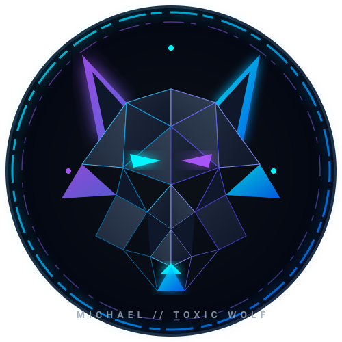

<div align="center">



# Hi there, I'm Michael 👋 
### Full-Stack Developer • Systems Builder • Product Engineer

[](https://vercel.com/okafoemichael-8303)
[](https://github.com/Mandypie)
[](#)

<p align="center">
  Building high-performance modern web apps, automation systems, real-time analytics platforms, and digital experiences.
</p>

---

</div>

## 🚀 Live Projects & Deployments (Vercel)

Here is a collection of my deployed applications, ranging from full-scale e-commerce marketplaces to real-time audio streamers, interactive gaming hubs, and web automation:

| Project | Tech Stack | Live Demo | Description |
| :--- | :--- | :---: | :--- |
| **ZVAULT** | Next.js 16, TypeScript, Tailwind CSS | [🔗 Visit Live](https://zvault-okafoemichael-8303.vercel.app) | UK premium authenticated sneaker & streetwear marketplace featuring verified listings and seamless checkout. |
| **Toxic Wolf Tunes** | Next.js, Web Audio API, TypeScript | [🔗 Visit Live](https://toxic-wolf-tunes.vercel.app) | Full-featured music streaming app featuring song search, curated catalogs, and full playback streaming. |
| **ToxicWolf Game Center** | React / Next.js, HTML5 Canvas | [🔗 Visit Live](https://toxicwolf-game-center.vercel.app) | Interactive web arcade and gaming center with low-latency responsive controls and custom mini-games. |
| **Polymarket Analytics** | Next.js, WebSocket / APIs, Recharts | [🔗 Visit Repo](https://github.com/Mandypie/polymarket-analytics) | Real-time prediction market intelligence dashboard providing live signals, volume tracking, and market analytics. |
| **Sofia Site** | Next.js, Tailwind CSS, Modern UI | [🔗 Visit Live](https://sofia-site-kohl.vercel.app) | Elegant digital showcase and portfolio crafted with high aesthetic fidelity and smooth micro-interactions. |
| **Nike Release Automation** | Node.js, Web Automation, APIs | [🔗 Visit Live](https://nike-account-creator-okafoemichael-8303.vercel.app) | Automated account generation and release intelligence system built for high-throughput drop monitoring. |
| **AG Fast Link Learn** | React, Next.js, Interactive UI | [🔗 Visit Live](https://ag-fast-link-learn-okafoemichael-8303.vercel.app) | Interactive speed-learning portal and workflow companion. |
| **CapCut Pro Portal** | Next.js, Serverless Functions | [🔗 Visit Live](https://capcut-pro-1-month.vercel.app) | Web landing portal and automated tool workflow demo. |

---

## 🛠️ Tech Stack & Tooling

```
Frontend    : Next.js (App Router), React, TypeScript, JavaScript, Tailwind CSS, HTML5/CSS3
Backend     : Node.js, RESTful APIs, Serverless Functions, WebSockets
Cloud & Ops : Vercel, Git / GitHub, Automation Scripts & Bots, Edge Networks
Database    : PostgreSQL, Supabase, Redis, Firebase
```

---

## ⚡ Active Focus & Engineering Highlights
- 🏎️ **Performance & Architecture**: Designing Next.js 15/16 apps with server components, dynamic caching, and sub-second page loads.
- 🎧 **Media & Real-time**: Building streaming clients and dashboard feeds with real-time push state.
- 🤖 **Automation**: Creating robust scripts and browser automation workflows for high-demand scenarios.

---

<div align="center">

*Feel free to explore my repositories or check out the live links above!*

</div>
